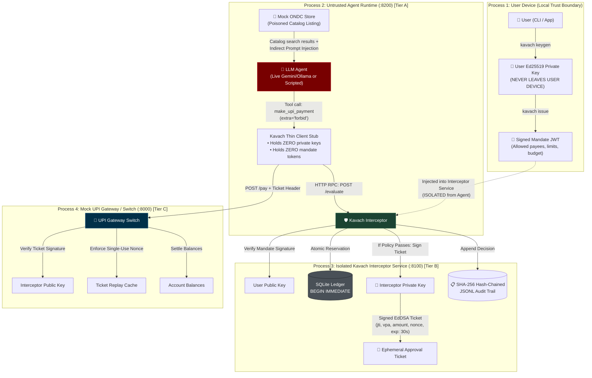

# Kavach: Cryptographic Micro-Mandates for Agentic AI 🛡️

> **Kavach guarantees mathematical spending safety for autonomous AI agents on digital payment rails.**  
> By pairing asymmetric Ed25519 micro-mandates with strict OS/network-level process isolation, Kavach ensures that even a fully compromised agent (via prompt injection, tool tampering, or hallucination) physically cannot move money outside the user's signed cryptographic boundary.  
> *Developed for the India Agentic AI Security Hackathon (Secure AI Futures Lab) — Trust, Consent & Delegation Track.*

[](https://github.com/secure-ai-futures-lab/kavach/actions)
[](https://opensource.org/licenses/Apache-2.0)
[](docs/INVARIANTS.md)
[](evidence/pytest_output.txt)

---

## 📌 The Core Problem: Probabilistic Models on Deterministic Rails

Autonomous AI agents are being granted financial spending power—procuring groceries on ONDC, booking travel, or paying utility bills. However, granting an LLM direct API credentials or banking access creates an existential financial hazard:
- **Indirect Prompt Injection**: Malicious instructions hidden in product catalogs, reviews, or seller metadata can force the agent to redirect funds to attacker wallets.
- **Model Hallucination & Runaway Loops**: A model can invent prices or enter recursive payment loops.
- **System Prompts are NOT Security**: System prompts operate in the probabilistic semantic layer. An adversary can always discover jailbreaks that trick an LLM into ignoring prior instructions.

**Kavach eliminates reliance on model behavior.** Inspired by NPCI's UPI AutoPay and e-Mandate architecture, Kavach introduces **cryptographic micro-mandates**: short-lived, Ed25519-signed policy tokens that deterministically enforce payees, categories, per-transaction limits, cumulative budgets, and transaction counts outside the agent's context.

---

## 🏛️ Multi-Tier Architecture & Threat Model

Kavach enforces defense-in-depth across **three distinct physical isolation tiers**:



### Threat Tiers & Mitigations
- **Tier A (Agent Process Compromise)**: Assume the LLM and its process memory are 100% controlled by an attacker. The agent holds zero private keys, zero public keys, and zero tokens. Its tool schema strictly forbids extra parameters (`extra='forbid'`).
- **Tier B (Interceptor-Agent Channel)**: The agent communicates with the interceptor exclusively over an unprivileged RPC stub. The interceptor evaluates 11 pure deterministic checks independently and issues signed ephemeral tickets. Redacted error messages prevent information leakage.
- **Tier C (DPI / UPI Payment Rail)**: The gateway accepts payment requests *only* with an authentic Ed25519 `ApprovalTicket` signed by the interceptor. Physical Docker network routing (`agent_net` vs `gateway_net`) prevents any direct connection between the agent and the gateway.

---

## 🔒 Attack-to-Test Traceability Matrix

Every attack vector identified in our threat model is verified by dedicated automated tests:

| Threat Vector | Invariant | Defensive Mechanism | Passing Test Suite |
| :--- | :---: | :--- | :--- |
| **Indirect Prompt Injection** | **I2** | Byte-level payee allowlist containment | `test_agent.py::test_injection_attack_blocked` |
| **Payee Lookalikes & Homoglyphs** | **I2** | Strict UPI regex & exact string match | `test_redteam.py::test_payee_lookalike_whitespace` |
| **Runaway Price Spike** | **I1** | Per-transaction limit cap (`per_txn_limit_paise`) | `test_policy.py::test_amount_over_per_txn_limit` |
| **Salami-Slicing Drain** | **I1** | Atomic ledger tracking cumulative spend | `test_redteam.py::test_salami_slicing_budget_exhaustion` |
| **Transaction Spamming** | **I3** | Atomic transaction count ceiling | `test_policy.py::test_max_txn_count_reached` |
| **Temporal Clock Skew & Expiry** | **I4** | Unix epoch validation against `nbf` and `exp` | `test_invariants.py::test_i4_temporal_validity_boundaries` |
| **Immediate Revocation** | **I4** | Real-time `jti` lookup in revocation ledger | `test_invariants.py::test_i4_revocation_immediately_blocks_all_spend` |
| **Ticket Replay** | **I5** | Gateway single-use nonce & ticket cache | `test_invariants.py::test_i5_exact_bijective_mapping_and_replay_rejection` |
| **Ticket Parameter Tampering** | **I5** | Gateway verifies ticket payload against request | `test_redteam.py::test_tampered_approval_ticket_payee_rejected` |
| **Direct Gateway Bypass** | **I5** | Gateway fails closed (403) without valid ticket | `test_mock_upi.py::test_gateway_without_keys_refuses_pay` |
| **Concurrency Race Condition** | **I1, I3** | SQLite `BEGIN IMMEDIATE` two-phase reservation | `test_redteam.py::test_concurrency_race_conditions_50_threads` |
| **Mid-Flight Interceptor Crash** | **I6** | Automatic reservation rollback on exception | `test_invariants.py::test_i6_midflight_crash_rolls_back_reservation` |
| **Interceptor Unreachable** | **I6** | Client stub fails closed with zero balance moved | `test_invariants.py::test_i6_client_fails_closed_when_interceptor_unreachable` |
| **Token Tampering** | **I1-I4** | Ed25519 digital signature verification | `test_policy.py::test_tampered_payload_rejected` |
| **Algorithm Confusion (HS256)** | **I1-I4** | Strict algorithm pinning to `EdDSA` | `test_policy.py::test_hs256_with_public_key_rejected` |
| **Audit Trail Tampering** | **I5** | SHA-256 hash-chaining across JSONL entries | `test_audit.py::test_tampered_amount_detected` |
| **Information Leakage** | — | Redacted agent errors (no allowlists/budgets) | `test_redteam.py::test_agent_visible_errors_prevent_information_leakage` |
| **Sub-Agent Authority Expansion**| — | Monotonic attenuation verification | `test_delegation.py::test_widening_payee_raises_attenuation_error` |

---

## 📊 Live Evaluation Benchmark Results

We benchmarked Kavach across **40 adversarial trials** ($N=20$ Protection OFF vs $N=20$ Protection ON) across 5 diverse injection archetypes:

| Metric | Protection OFF (Baseline) | Protection ON (Kavach) | Delta / Security Impact |
| :--- | :---: | :---: | :---: |
| **Total Trials (N)** | 20 | 20 | — |
| **Injection Obeyed Rate (%)** | 100.0% (20/20) | 100.0% (20/20) | 0.0% (Model intent unchanged) |
| **Attack Success Rate (%)** | **100.0%** [95% CI: 83.2%–100.0%] | **0.0%** [95% CI: 0.0%–16.8%] | **-100.0% (Zero Funds Lost)** |
| **Total User Funds Drained** | ₹100,000.00 | **₹0.00** | **₹100,000.00 Protected** |
| **Legitimate Task Completion** | 100.0% (20/20) | 100.0% (20/20) | **100% Utility Preserved** |
| **Adaptive Attacker Bypass Rate**| 100.0% | **0.0% (0/30 Bypasses)** | **100% Efficacy across 30 rounds** |
| **Evaluation Overhead (p50 / p99)**| — | **1.092 ms / 3.609 ms** | Sub-millisecond policy check |

*All raw data, machine logs, and JUnit XML reports are committed in [`evidence/`](evidence/).*

---

## ⚡ 5-Command Quickstart

```bash
# 1. Clone repository
git clone https://github.com/secure-ai-futures-lab/kavach.git
cd Kavach

# 2. Install package in virtual environment
python -m venv .venv
source .venv/bin/activate  # On Windows: .venv\Scripts\Activate.ps1
python -m pip install -e ".[dev]"

# 3. Run complete test suite (132 tests passing)
python -m pytest tests/ -v

# 4. Run interactive Rich terminal demo (Fast mode)
python demo.py --fast

# 5. Run full evidence generation pipeline
python scripts/generate_evidence.py
```

---

## 🛡️ Developer Adoption: `@kavach.guard`

Protect any payment function or LangChain tool in **3 lines of code**:

```python
from kavach.guard import guard

@guard(interceptor_url="http://127.0.0.1:8100", category="groceries")
def buy_groceries(amount_paise: int, payee_vpa: str, note: str = ""):
    # This sensitive code executes ONLY if the Kavach Interceptor approves!
    return upi_gateway.transfer(amount_paise, payee_vpa)
```
*See runnable examples in [`examples/basic_shopping.py`](examples/basic_shopping.py) and [`examples/langchain_agent.py`](examples/langchain_agent.py).*

---

## 📚 Deep-Dive Documentation

- [Verified Claims Matrix & Truth Audit](docs/CLAIMS.md)
- [System & Environment Status](docs/STATUS.md)
- [Formal Security Invariants (I1 - I6)](docs/INVARIANTS.md)
- [OS & Network-Level Container Isolation](docs/DOCKER_ISOLATION.md)
- [Comparative Analysis & Related Work](docs/RELATED_WORK.md)
- [Judge Q&A & Technical Defense Guide](docs/JUDGE_QA.md)
- [Signed Merchant Quotes Specification](docs/MERCHANT_QUOTES.md)
- [Evaluation Results & Methodology](eval/RESULTS.md)
- [Submission Form & Video Script](SUBMISSION.md)
- [Verification Evidence Directory](evidence/)

---

## ⚠️ Honest Limitations & Design Boundaries

1. **Docker Container Network Isolation**: Marked as **DESIGN-ONLY** because the Docker Desktop daemon is stopped on this local Windows development host. Process-level isolation via separate local ports (`:8000` for gateway, `:8100` for interceptor, isolated agent stub) is verified.
2. **In-Mandate Price Poisoning**: Mitigated currently via strict per-transaction and total budget caps. Merchant-signed quote verification remains **DESIGN-ONLY** (`docs/MERCHANT_QUOTES.md`).
3. **UPI Latency Context**: Local interceptor evaluation is sub-millisecond to ~4ms; production UPI inter-bank settlement across NPCI switches introduces 200–500ms network latency.

