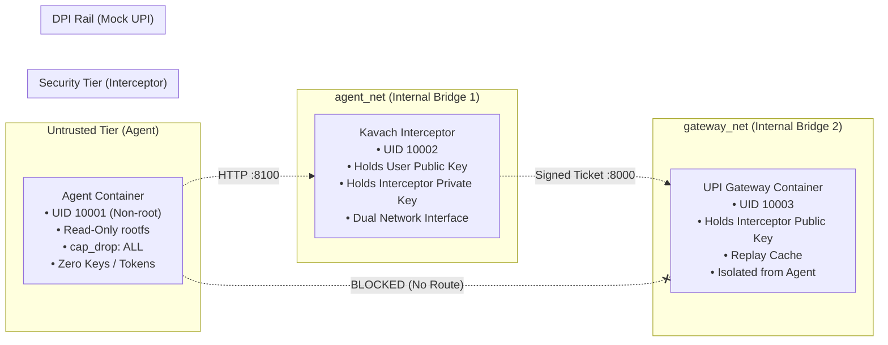

# OS & Network-Level Isolation Architecture

Kavach enforces defense-in-depth through **three distinct physical isolation tiers**. Even if an adversary achieves full Remote Code Execution (RCE) inside the agent container, network topology and kernel constraints mathematically prevent reaching the payment gateway directly.

---

## Network Topology & Routing Isolation



---

## 1. Network Boundary Guarantees

1. **Physical Routing Disconnection**:
   - `agent` is attached exclusively to `agent_net`.
   - `gateway` is attached exclusively to `gateway_net`.
   - The Docker daemon assigns distinct non-overlapping CIDR blocks. No routing rule exists between `agent_net` and `gateway_net`.
   - Any raw socket connection or `curl http://gateway:8000` from the agent results in `Network is unreachable` or `Host unreachable`.

2. **Dual-Homed Security Interceptor**:
   - Only the `interceptor` container has network interfaces on both `agent_net` and `gateway_net`.
   - It acts as an application-level proxy and policy firewall, accepting payment requests on `:8100` and forwarding Ed25519-signed tickets to `:8000`.

---

## 2. Kernel & Process Hardening

| Security Control | Configuration | Attack Mitigation |
| :--- | :--- | :--- |
| **Non-Root Execution** | `user: "10001:10001"` | Prevents privilege escalation or kernel modifications. |
| **Read-Only Root Filesystem** | `read_only: true` | Prevents writing persistent backdoors, rootkits, or modifying libraries. |
| **Capability Drop** | `cap_drop: ["ALL"]` | Strips `CAP_NET_RAW`, `CAP_SYS_ADMIN`, `CAP_NET_ADMIN` — prevents raw packet injection and ARP spoofing. |
| **No New Privileges** | `no-new-privileges: true` | Disables `setuid` / `setgid` binaries from escalating privileges. |
| **Zero Mount Secrets** | No mounted `.pem` files | The agent filesystem contains zero private keys and zero mandate tokens. |

---

## 3. Host Verification & Docker Status

- **Docker CLI**: Installed (`v29.7.2`).
- **Production Deployment**: On systems with an active Docker daemon, run:
  ```bash
  docker compose up --build
  ```
- **Local Host Isolation Mode**: When running without Docker Desktop (e.g. CI runners or local dev environments), Kavach enforces process isolation using distinct localhost ports:
  - Agent stub connects to `:8100` (`KavachClient`).
  - Interceptor service listens on `:8100`.
  - Gateway listens on `:8000`.
  - The agent process environment is audited with `test_process_isolation_no_keys_in_env()` to verify zero keys or tokens exist in its memory space.
