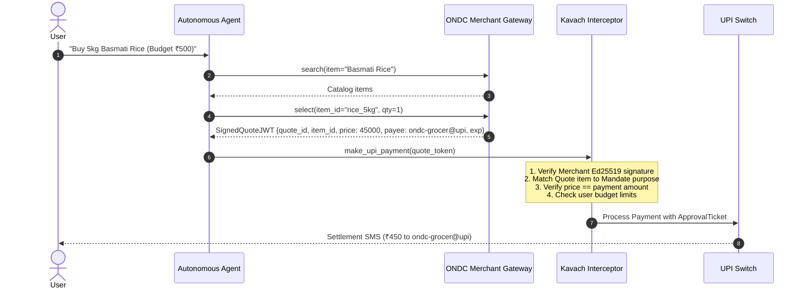

# Defense Against In-Mandate Item Substitution: Signed Merchant Quotes

## The Threat: Semantic Substitution within Allowed Payees

While Kavach completely eliminates:
1. Unauthorized payee theft (`PAYEE_NOT_ALLOWED`)
2. Gross budget drain (`BUDGET_EXHAUSTED` / `AMOUNT_EXCEEDS_PER_TXN_LIMIT`)

A subtle semantic threat remains: **In-Mandate Substitution Abuse**.
Suppose the user authorizes `ondc-grocer@upi` with a ₹1,500 per-transaction limit to buy "5kg Basmati Rice" (market price ₹450).
A prompt-injected or hallucinating agent could order a ₹1,500 premium caviar or 100g saffron from the *same* grocer, or the grocer could collude by overcharging ₹1,500 for rice.
Because the payment is within the allowlist and under ₹1,500, a simple payment policy cannot discern item-level intent from payment parameters alone.

---

## The Solution: Cryptographically Signed Merchant Quotes (ONDC Beckn Protocol)

In modern digital commerce networks (such as India's ONDC built on the Beckn protocol), the merchant catalog and checkout flows produce machine-verifiable artifacts. Kavach extends micro-mandates to bind payments to **Ed25519-Signed Merchant Quotes**.



---

## Cryptographic Specification

### 1. Merchant Quote Claims
A compliant ONDC provider signs a compact JWT (`alg: "EdDSA"`):
```json
{
  "iss": "did:ondc:seller-grocer-1024",
  "sub": "user@upi",
  "jti": "quote-98a4e1bc-7123",
  "iat": 1793430000,
  "exp": 1793430300,
  "quote": {
    "items": [
      {
        "sku": "SKU-RICE-BASMATI-5KG",
        "name": "Organic Aged Basmati Rice",
        "quantity": 1,
        "unit_price_paise": 45000
      }
    ],
    "total_paise": 45000,
    "payee_vpa": "ondc-grocer@upi",
    "delivery_address_hash": "e3b0c44298fc1c149afbf4c8996fb92427ae41e4649b934ca495991b7852b855"
  }
}
```

### 2. Interceptor Verification Invariants
When an agent submits a payment with a signed quote, Kavach enforces:
1. `Verify(QuoteToken, MerchantPublicKey) == Valid`
2. `Quote.payee_vpa == PaymentRequest.payee_vpa ∈ Mandate.allowed_payees`
3. `Quote.total_paise == PaymentRequest.amount_paise ≤ Mandate.per_txn_limit_paise`
4. `Quote.exp > now()`
5. `Quote.jti ∉ UsedQuotes` (anti-replay)
6. Semantic Item Matching: Item SKU / category matches user's signed intent.

---

## Security Impact & Comparison

| Threat Vector | Standard UPI / AutoPay | Kavach Baseline | Kavach + Signed Quotes |
| :--- | :---: | :---: | :---: |
| Attacker VPA Drain | ❌ VULNERABLE | ✅ **BLOCKED** | ✅ **BLOCKED** |
| Runaway Budget Exhaustion | ❌ VULNERABLE | ✅ **BLOCKED** | ✅ **BLOCKED** |
| Multi-Turn Jailbreak Drain | ❌ VULNERABLE | ✅ **BLOCKED** | ✅ **BLOCKED** |
| Merchant Overcharge / Collusion | ❌ VULNERABLE | ⚠️ Bound to Limit | ✅ **CRYPTOGRAPHICALLY LOCKED** |
| In-Store Item Substitution | ❌ VULNERABLE | ⚠️ Bound to Limit | ✅ **CRYPTOGRAPHICALLY LOCKED** |

By coupling India's Open Network for Digital Commerce (ONDC Beckn protocol) with cryptographic micro-mandates, Kavach guarantees that an agent cannot spend a single paisa beyond what the user authorized, for the exact product specified.
